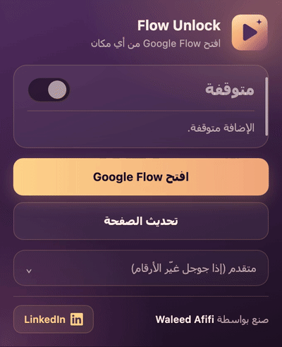
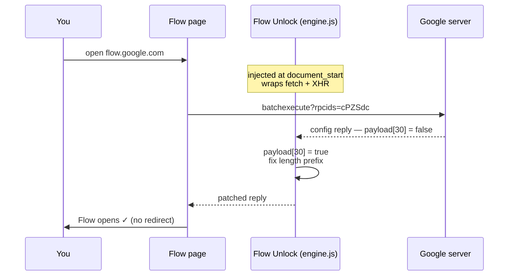
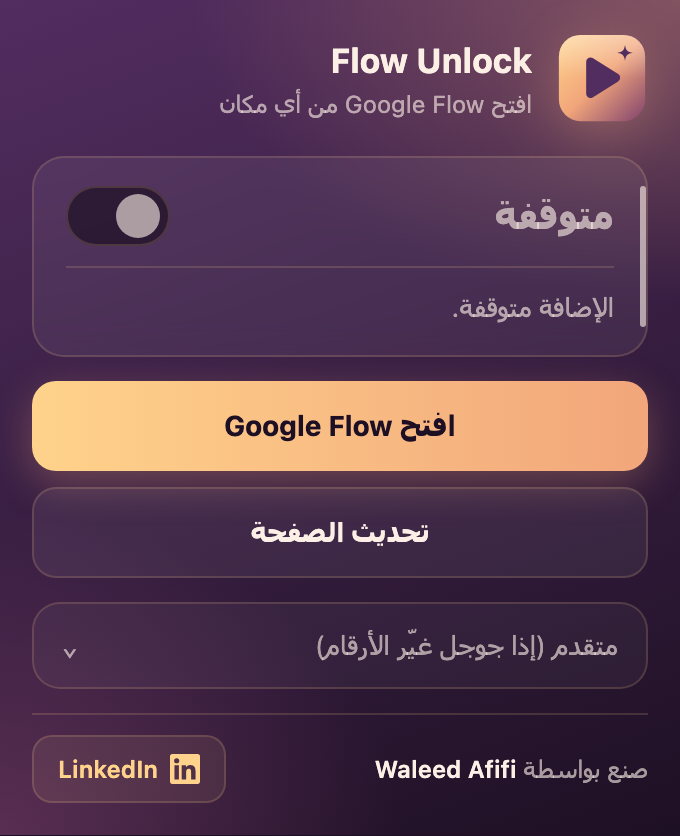
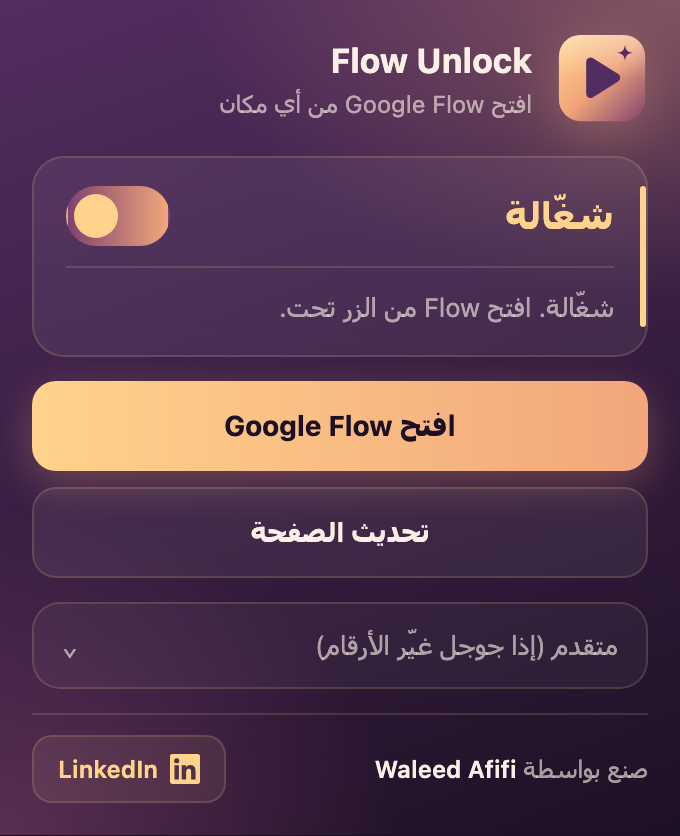
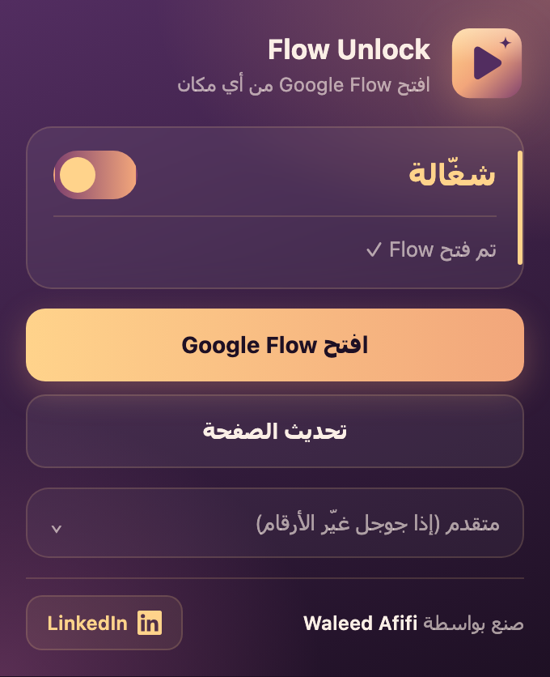
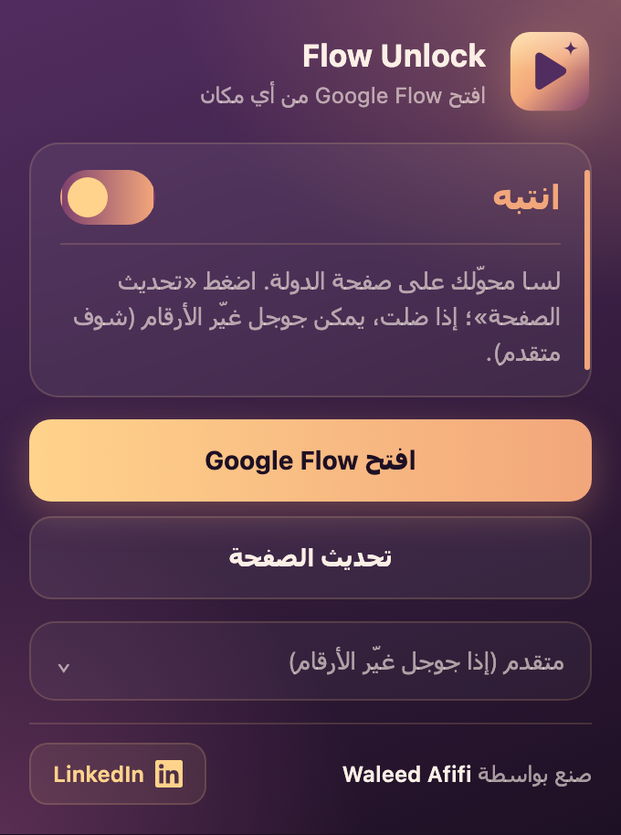
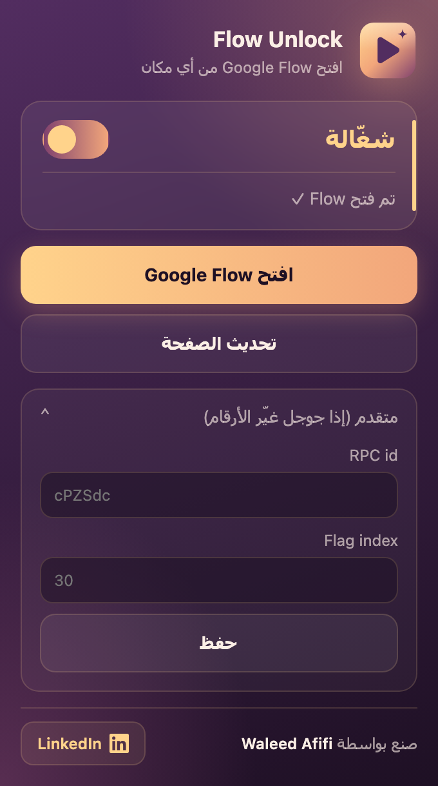

<div align="center">


# Flow Unlock

**افتح Google Flow من أي دولة — بدون VPN وبدون بروكسي**

Open Google Flow from any country — no VPN, no proxy.


[العربية](#العربية) · [English](#english)



<sub>🎬 <a href="docs/demo.mp4">نسخة الفيديو MP4 / MP4 video</a></sub>

</div>

---

<div dir="rtl">

## العربية

### شو هي؟

**Flow Unlock** إضافة لمتصفح كروم بتحل مشكلة رسالة *"Flow is not available in your country"* اللي بتطلع لما تفتح [Google Flow](https://flow.google.com) من دولة مش مدعومة.

الإضافة **ما بتغيّر الـIP تبعك** وما بتمرّر الإنترنت عبر أي سيرفر. كل الشغل بيصير جوا متصفحك وعلى صفحة Flow بس.

### المميزات

- ⚡ **ضغطة وحدة** — شغّل المفتاح وافتح Flow.
- 🔒 **محلية 100%** — ما في أي اتصال بسيرفر خارجي، ولا تتبع، ولا إحصائيات.
- 🎯 **محصورة بـFlow** — ما بتلمس أي موقع تاني.
- 🛠️ **قابلة للتحديث بدون كود** — إذا جوجل غيّر الأرقام الداخلية، بتغيّرها من قسم «متقدم».
- 🎨 **واجهة عربية** مع حالة واضحة: شغّالة / انتبه / متوقفة.

### كيف بتشتغل؟

لما تفتح Flow، الصفحة بتطلب من جوجل إعدادات الحساب عبر طلب داخلي اسمه `batchexecute` (رقمه `cPZSdc`). الرد فيه مصفوفة، والخانة رقم **30** فيها هي علامة «هل Flow متاح بدولتك؟». إذا كانت `false`، الصفحة بتحوّلك على `/unsupported-country`.

الإضافة بتحط سكربت صغير بالصفحة **قبل ما تحمّل**، بيلقط هاد الرد ويقلب العلامة لـ`true` قبل ما يقرأها تطبيق Flow.

</div>



<div dir="rtl">

تفاصيل تقنية:

| الخطوة | شو بيصير |
|---|---|
| ١ | `background.js` بيسجّل `engine.js` بعالم الصفحة (`MAIN`) و`bridge.js` بعالم الإضافة (`ISOLATED`) على `flow.google.com` و`labs.google/fx` وقت `document_start`. |
| ٢ | `engine.js` بيلف `window.fetch` و`XMLHttpRequest` — وبيتدخل **بس** بطلبات `batchexecute` اللي فيها `rpcids=cPZSdc`. |
| ٣ | بيفك الرد (`wrb.fr` envelope)، بيحط `true` بالخانة 30 (وبالخانة 31 إذا كانت `false`)، وبيصلّح رقم الطول اللي قبل السطر. |
| ٤ | بيسجّل النتيجة على `<html data-flow-unlock>` لحتى `bridge.js` يوصلها للنافذة. |

### التركيب

1. نزّل المشروع:
   - من زر **Code → Download ZIP** وفك الضغط، أو:

</div>

```bash
git clone <repo-url> flow-unlock
```

<div dir="rtl">

2. افتح `chrome://extensions`.
3. شغّل **Developer mode** (فوق على اليمين).
4. اضغط **Load unpacked** واختار مجلد المشروع.
5. ثبّت الأيقونة بشريط كروم من زر 🧩.

> بتشتغل كمان على Edge وBrave وOpera وArc وأي متصفح مبني على Chromium.

### الاستخدام

1. اضغط أيقونة **Flow Unlock** وتأكد إنه المفتاح شغّال.
2. اضغط **افتح Google Flow**.
3. إذا كانت صفحة Flow مفتوحة من قبل، اضغط **تحديث الصفحة**.

### حالات الواجهة

<table>
<tr>
<td align="center" width="33%"><br/><b>متوقفة</b><br/><sub>المفتاح مطفي، Flow رح يتحوّل لصفحة الدولة.</sub></td>
<td align="center" width="33%"><br/><b>شغّالة</b><br/><sub>جاهزة — افتح Flow من الزر.</sub></td>
<td align="center" width="33%"><br/><b>تم فتح Flow ✓</b><br/><sub>الرد اتعدّل والصفحة فتحت.</sub></td>
</tr>
<tr>
<td align="center"><br/><b>انتبه</b><br/><sub>الصفحة انفتحت قبل الإضافة أو لسا على صفحة الدولة — اضغط «تحديث الصفحة».</sub></td>
<td align="center" colspan="2"><br/><b>متقدم</b><br/><sub>تغيير الـRPC id ورقم الخانة إذا جوجل غيّرهم.</sub></td>
</tr>
</table>

### حل المشاكل

| المشكلة | الحل |
|---|---|
| لسا بيطلعلي «not available in your country» | اضغط **تحديث الصفحة** من الإضافة، أو سكّر التاب وافتح Flow من زر الإضافة. |
| الحالة «انتبه» ما بتروح | امسح الكوكيز تبع `flow.google.com` وجرّب مرة تانية. |
| بطّلت تشتغل فجأة بعد فترة | غالباً جوجل غيّر الأرقام الداخلية — شوف القسم الجاي. |
| الواجهة فتحت بس التوليد بيفشل | جوجل ممكن يفحص الدولة بالسيرفر وقت التوليد؛ هاد خارج قدرة أي إضافة. |

### إذا جوجل غيّر الأرقام (قسم «متقدم»)

1. افتح Flow واضغط `F12` ← تبويب **Network**.
2. فلتر على `batchexecute` وحدّث الصفحة.
3. دوّر على الطلب اللي ردّه فيه إعدادات الحساب — قيمة `rpcids` بالرابط هي الـ**RPC id**.
4. بالرد، دوّر على الخانة اللي قيمتها `false` وبتتغير حسب الدولة — رقمها هو الـ**Flag index**.
5. حط القيم بقسم **متقدم** واضغط **حفظ**، وبعدين **تحديث الصفحة**.

### هيكل المشروع

</div>

```text
flow-unlock/
├── manifest.json     # تعريف الإضافة (Manifest V3) والصلاحيات
├── background.js     # بيسجّل/بيشيل السكربتات حسب المفتاح
├── engine.js         # قلب الإضافة: بيعدّل رد batchexecute جوا الصفحة
├── bridge.js         # وسيط بين الصفحة والنافذة (إعدادات + حالة)
├── popup.html        # واجهة النافذة
├── popup.js          # منطق النافذة
├── icons/            # الأيقونة (SVG + PNG 16/32/48/128)
└── docs/             # السكرينات والفيديو
```

<div dir="rtl">

### الخصوصية والصلاحيات

| الصلاحية | ليش |
|---|---|
| `scripting` | لتسجيل السكربت على صفحة Flow. |
| `storage` | لحفظ حالة المفتاح وإعدادات «متقدم». |
| `flow.google.com` · `labs.google` | المواقع الوحيدة اللي بتشتغل عليها الإضافة. |

- ما في أي طلب لسيرفر خارجي، ولا جمع بيانات، ولا تحديثات عن بُعد.
- كل الكود مفتوح وقصير — بتقدر تقرأه كله بدقائق.

### تنبيه

هاي الإضافة بتعدّل فحص الدولة **بالواجهة بس**. هاد ممكن يكون مخالف لشروط استخدام جوجل، وفي احتمال يتقيّد الحساب. استعملها على مسؤوليتك. الإضافة مش تابعة لجوجل ولا مدعومة منها.

### المطوّر

**Waleed Afifi** — [LinkedIn](https://www.linkedin.com/in/walafifi/)

</div>

---

## English

### What is it?

**Flow Unlock** is a Chrome extension that gets past Google Flow's *"Flow is not available in your country"* screen. It does **not** change your IP or route traffic anywhere — it works entirely inside your browser, on Flow's pages only.

### Features

- ⚡ One switch — turn it on, open Flow.
- 🔒 100% local — no external servers, no tracking, no analytics.
- 🎯 Scoped to Flow only.
- 🛠️ Updatable without code — if Google changes its internal IDs, edit them under *Advanced*.

### How it works

On load, Flow asks Google for account config via an internal `batchexecute` RPC (`cPZSdc`). Index **30** of the reply payload is the "available in your country" flag; when it's `false`, the app redirects to `/unsupported-country`.

Flow Unlock injects `engine.js` into the page at `document_start`, wraps `fetch` and `XMLHttpRequest`, and — for that one RPC only — sets the flag to `true` (and index 31 if it's `false`), fixes the chunk length prefix, and hands the patched reply back to the app. See the sequence diagram above.

### Install

1. Download the repo (**Code → Download ZIP**) or `git clone` it.
2. Open `chrome://extensions` and enable **Developer mode**.
3. Click **Load unpacked** and select the project folder.
4. Pin the icon from the 🧩 menu.

Works on any Chromium browser (Edge, Brave, Opera, Arc…).

### Usage

1. Click the **Flow Unlock** icon and make sure the switch is on.
2. Click **افتح Google Flow** (Open Google Flow).
3. If Flow was already open, click **تحديث الصفحة** (Reload page).

### Troubleshooting

| Problem | Fix |
|---|---|
| Still seeing "not available in your country" | Click *Reload page* in the popup, or close the tab and open Flow from the popup. |
| Status stays on the warning state | Clear cookies for `flow.google.com` and retry. |
| Stopped working after a while | Google likely changed the RPC id or flag index — update them under *Advanced* (find them in DevTools → Network → filter `batchexecute`). |
| UI opens but generation fails | Google may also enforce region server-side; no extension can change that. |

### Permissions & privacy

`scripting` (inject on Flow), `storage` (switch + advanced settings), host access to `flow.google.com` and `labs.google` only. No network requests of its own, no data collection, no remote config.

### Disclaimer

This changes the region check **client-side only**. It may violate Google's Terms of Service and could lead to account restrictions — use at your own risk. Not affiliated with or endorsed by Google.

### Author

**Waleed Afifi** — [LinkedIn](https://www.linkedin.com/in/walafifi/)
